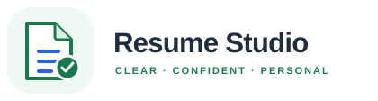

<p align="center">
  
</p>

<h1 align="center">Resume Studio</h1>

<p align="center">Build a thoughtful CV, tailor it to a role, and create a matching cover letter — all in one local workspace.</p>

<p align="center"><a href="https://youtu.be/aEDAM6XIsAg"></a></p>

Resume Studio is a local Streamlit app for turning career notes into polished, editable application documents. It uses [RenderCV](https://rendercv.com/) to render CV PDFs from structured YAML with RenderCV's templates. Keep your experience in your own words, optionally get AI-assisted suggestions, and review every change before saving or generating a PDF.

## What you can do

- **Build a CV:** edit your profile, summary, experience, achievements, education, certifications, skills, and links.
- **Start from an existing CV:** import RenderCV YAML, selectable-text PDF, DOCX, or TXT into editable fields. Scanned PDFs and legacy `.doc` files are not supported.
- **Refine with AI:** choose Codex CLI, Gemini CLI, or Claude Code for imports, wording suggestions, achievement grouping, and job-description alignment. Suggestions are reviewable before they change your draft.
- **Customize AI prompts:** edit the task-specific text files in `prompts/`; changes are loaded the next time the action runs.
- **Check ATS alignment:** optionally compare your CV with a job description and see matching terms, gaps, and targeted suggestions. ATS mode is off by default.
- **Preview and generate:** preview RenderCV templates with sample content, then use RenderCV to generate and download your CV PDF from the saved YAML.
- **Write a cover letter:** start with an existing CV or a description of your background, add a job description if useful, and edit the resulting draft.
- **Keep useful source files:** save career notes as Markdown alongside the structured RenderCV YAML and generated resume artifacts.

## Get started

Use Python 3.12 or newer.

```bash
git clone <repository-url>
cd ResumeStudio
python3 -m venv .venv
source .venv/bin/activate
python -m pip install -r requirements.txt
streamlit run app.py
```

Open the local address printed in the terminal. Start with the blank sample CV or import your own resume. Personal career notes, imported resumes, and generated resume files stay local and are excluded from Git.

### Optional AI providers

AI features use a locally installed CLI and its existing sign-in. Install and authenticate the provider you want to use; ordinary editing, saving, and PDF generation work without one.

| Provider | CLI command |
| --- | --- |
| OpenAI Codex | `codex` |
| Google Gemini | `gemini` |
| Anthropic Claude Code | `claude` |

The chosen CLI receives the text needed for the action you request, such as resume content and, when ATS mode is on, the job description. The app does not call provider APIs directly or store provider API keys.

## Typical workflow

1. Open **CV Builder** and load a YAML, PDF, DOCX, or TXT resume, or start a blank CV.
2. Review imported content and edit the fields. Add a profile photo if you want one.
3. Optionally choose an AI provider to refine text or categorize achievements. Review and accept suggestions individually.
4. Turn on ATS mode only when you want refinements aligned with a specific job description. Paste the description or load it from a supported text-based file.
5. Choose a template to preview it with sample data, then generate your CV PDF.
6. Use **Files** to download Markdown source notes or generated CV files.
7. Open **Cover Letter** to draft a letter from your CV and job description, or from your own background description.

Personal career notes under `data/` and imported or generated resumes under `resumes/` are local-only and gitignored. The repository includes a blank sample CV at `assets/sample_cv.yaml` for app defaults and template settings.

## Project map

```text
app.py                         Streamlit entry point and navigation
app_pages/                     CV Builder and Cover Letter views
src/cv_builder/                Import, storage, provider, and RenderCV logic
prompts/                       Editable AI prompt templates
assets/                        Resume Studio logo and visual assets
data/                          Local-only career notes (gitignored)
resumes/                       Local-only CV inputs and generated outputs (gitignored)
assets/sample_cv.yaml          Blank generic RenderCV starter configuration
tests/                         Provider adapter tests
requirements.txt               Python dependencies
architecture-plan.md           Detailed architecture and implementation notes
```

RenderCV is the CV rendering engine: Resume Studio prepares the RenderCV YAML, applies the selected RenderCV template, and invokes RenderCV to produce the PDF.

## Architecture and project video

- [Architecture plan](architecture-plan.md) describes the components, data flow, local AI CLI providers, RenderCV integration, and implementation decisions.
- [High-level architecture diagram](.archify/architecture-resume-studio-20261010-231114/resume-studio-architecture.html) shows the app components and their connections.
- [User workflow diagram](.archify/workflow-resume-studio-20261010-231114/resume-studio-workflow.html) includes CV import and RenderCV PDF generation, plus the AI CLI cover letter flow.
- [40-second Resume Studio video](brag-output-2026-10-10-231114/composition/renders/composition_2026-10-10_23-32-34.mp4) is the rendered launch/brag video. Its HyperFrames project and brief are in [brag-output-2026-10-10-231114](brag-output-2026-10-10-231114/).

## Run checks

```bash
python -m unittest discover -s tests -v
```

## Notes

- PDF import requires selectable text; OCR is not included.
- Phone numbers are optional. For best RenderCV validation, enter them as quoted international numbers, including the country code (for example, `+49...`).
- AI-generated text can be inaccurate. Check names, dates, technologies, and metrics before accepting or exporting a suggestion.
- See [the architecture plan](architecture-plan.md) for data flow, provider behavior, and planned follow-on tools.
