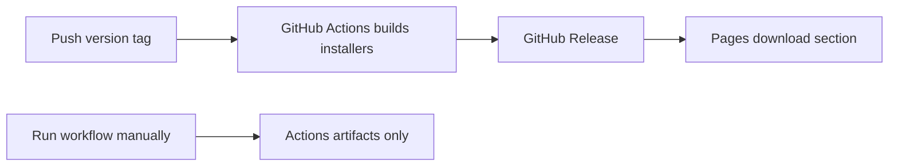

<p align="center">
  
</p>

<h1 align="center">Resume Studio</h1>

<p align="center">Build a thoughtful CV, tailor it to a role, and create a matching cover letter — all in one local workspace.</p>

<p align="center">
  <a href="https://www.python.org/"></a>
  <a href="https://streamlit.io/"></a>
  <a href="https://rendercv.com/"></a>
  
</p>

Resume Studio is a local Streamlit app for turning career notes into polished, editable application documents. It uses [RenderCV](https://rendercv.com/) to render CV PDFs from structured YAML with RenderCV's templates. Keep your experience in your own words, optionally get AI-assisted suggestions, and review every change before saving or generating a PDF.

> **Enjoying Resume Studio?** [Star the project on GitHub](https://github.com/FaniBhushan/ResumeStudio) to support its development.

## Quick start

Run these commands from a terminal with Python 3.12 or newer:

```bash
git clone https://github.com/FaniBhushan/ResumeStudio.git
cd ResumeStudio
python3 -m venv .venv
source .venv/bin/activate
python -m pip install -r requirements.txt
streamlit run app.py
```

Open the local address Streamlit prints. In **CV Builder**, start with the blank CV or import a RenderCV YAML, selectable-text PDF, DOCX, or TXT file. Review and edit the fields, then save your CV and generate a PDF. Open **Cover Letter** to create a draft from your CV or background notes. AI features are optional; configure a local provider CLI if you want suggestions.

## Desktop installers

### Downloads

Get the latest installers from the [download page](https://fanibhushan.github.io/ResumeStudio/) or [GitHub Releases](https://github.com/FaniBhushan/ResumeStudio/releases).

| Platform | Installer | Install |
| --- | --- | --- |
| Windows x64 | `.exe` | Run setup. SmartScreen may warn because the installer is unsigned. |
| macOS Apple silicon | `macOS-arm64.dmg` | Open the DMG; drag the app to **Applications**. |
| macOS Intel | `macOS-x64.dmg` | Open the DMG; drag the app to **Applications**. |
| Linux x86_64 | `.AppImage` | Run `chmod +x ResumeStudio-*.AppImage`, then `./ResumeStudio-*.AppImage`. FUSE 2 may be required. |

**Closing the desktop app:** Quit Resume Studio from its Dock (macOS), taskbar (Windows), or application menu (Linux). Closing the browser tab alone does not stop the local server.

**FAQ — Why does clicking the app appear to do nothing?** Resume Studio may already be running in the background and using its local port. Check for an open page at `http://127.0.0.1:8501`; otherwise quit the existing app process in your system’s app or process manager, then launch it again.

> **macOS warning — read the exact alert.** This free app is not notarized by Apple. For **“Apple cannot check it for malicious software,”** try opening it, then choose **System Settings → Privacy & Security → Open Anyway** and confirm only if you trust this GitHub release. For **“app is damaged and moved to the Bin,” stop**: Apple says this can indicate corruption, alteration, or a malware block. Do not override that alert or disable macOS checks. See [Apple’s guidance](https://support.apple.com/en-ie/102445) and the [illustrated macOS guide](https://fanibhushan.github.io/ResumeStudio/getting-started/macos/).

### Documentation

The public site is built with Material for MkDocs and deployed to GitHub Pages. To preview documentation changes locally:

```bash
python -m pip install -r requirements-docs.txt
mkdocs serve
```

The Pages workflow builds with `mkdocs build --strict` when documentation or its configuration changes.

### Optional AI command-line tools

AI support is optional. See [Optional AI providers](#optional-ai-providers) for install commands, sign-in steps, and provider requirements.

### Release flow



The workflow builds Windows x64, macOS Intel and Apple silicon, and Linux x86_64. To create a public release, push a version tag such as `v0.2.0`. Manual runs create downloadable Actions artifacts without publishing a release.

<details>
<summary>Enable trusted macOS releases</summary>

Apple Developer ID signing and notarization credentials are required. Configure all six repository secrets: `MACOS_CERTIFICATE_P12`, `MACOS_CERTIFICATE_PASSWORD`, `MACOS_SIGNING_IDENTITY`, `APPLE_API_KEY_P8_BASE64`, `APPLE_API_KEY_ID`, and `APPLE_API_ISSUER_ID`. The workflow signs and notarizes each DMG. Partial configuration fails the macOS build.

</details>

**Device support:** Resume Studio is designed for use in a desktop or laptop browser. The interface is not currently optimized for mobile screens.

Personal notes, imported resumes, and generated documents are stored locally in `data/` and `resumes/`; these folders are excluded from Git.

<p align="center"><a href="https://youtu.be/aEDAM6XIsAg"></a></p>

## What you can do

- **Build a CV:** edit your profile, summary, experience, achievements, education, certifications, skills, and links.
- **Start from an existing CV:** import RenderCV YAML, selectable-text PDF, DOCX, or TXT into editable fields. Scanned PDFs and legacy `.doc` files are not supported.
- **Refine with AI:** choose Codex CLI, Gemini CLI, or Claude Code for imports, wording suggestions, achievement grouping, and job-description alignment. Suggestions are reviewable before they change your draft.
- **Customize AI prompts:** edit the task-specific text files in `prompts/`; changes are loaded the next time the action runs.
- **Check ATS alignment:** optionally compare your CV with a job description and see matching terms, gaps, and targeted suggestions. ATS mode is off by default.
- **Preview and generate:** preview RenderCV templates with sample content, then use RenderCV to generate and download your CV PDF from the saved YAML.
- **Write a cover letter:** start with an existing CV or a description of your background, add a job description if useful, and edit the resulting draft.
- **Keep useful source files:** save career notes as Markdown alongside the structured RenderCV YAML and generated resume artifacts.

### Optional AI providers

AI features use a locally installed CLI and its existing sign-in. Install one provider below, then launch the CLI once and follow its sign-in prompts. Ordinary editing, saving, and PDF generation work without an AI provider.

| Provider | Install | First run and sign in |
| --- | --- | --- |
| [OpenAI Codex](https://developers.openai.com/codex/cli/) | `npm install -g @openai/codex@latest` | Run `codex` and choose an available sign-in method. |
| [Google Gemini CLI](https://github.com/google-gemini/gemini-cli/blob/main/docs/get-started/index.md) | `npm install -g @google/gemini-cli` | Run `gemini` and follow its authentication prompts. |
| [Anthropic Claude Code](https://code.claude.com/docs/en/getting-started) | `npm install -g @anthropic-ai/claude-code` | Run `claude` and follow the browser login prompts. |

Install Node.js and npm first. Gemini CLI requires Node.js 20 or newer; Claude Code's npm installation requires Node.js 22 or newer. Check availability with `node --version` and `npm --version`. After installing and signing in, start or restart Streamlit from a terminal where the provider command works, so the app inherits the correct `PATH`. Verify with `codex --version`, `gemini --version`, or `claude --version`.

The chosen CLI receives the text needed for the action you request, such as resume content and, when ATS mode is on, the job description. The app does not call provider APIs directly or store provider API keys.

## Typical workflow

1. Open **CV Builder** and load a YAML, PDF, DOCX, or TXT resume, or start a blank CV.
2. Review imported content and edit the fields. Add a profile photo if you want one.
3. Optionally choose an AI provider to refine text or categorize achievements. Review and accept suggestions individually.
4. Turn on ATS mode only when you want refinements aligned with a specific job description. Paste the description or load it from a supported text-based file.
5. Choose a template to preview it with sample data, then generate your CV PDF.
6. Use **Files** to download Markdown source notes or generated CV files.
7. Open **Cover Letter** to draft a letter from your CV and job description, or from your own background description.

Personal career notes under `data/` and imported or generated resumes under `resumes/` are local-only and gitignored. The repository includes a blank sample CV at `assets/sample_cv.yaml` for app defaults and template settings.

## Roadmap

### Planned

- Add support for connecting AI providers with user-supplied API keys.
- Add support for local language models served by [Ollama](https://ollama.com/).

### Long-term direction

- Build a web-based version with a Vue or React frontend and a Python backend exposed through an API.
- Offer a free local installer, with an optional paid AI assistant.

## Project map

```text
app.py                         Streamlit entry point and navigation
app_pages/                     CV Builder and Cover Letter views
src/cv_builder/                Import, storage, provider, and RenderCV logic
prompts/                       Editable AI prompt templates
assets/                        Resume Studio logo and visual assets
data/                          Local-only career notes (gitignored)
resumes/                       Local-only CV inputs and generated outputs (gitignored)
assets/sample_cv.yaml          Blank generic RenderCV starter configuration
tests/                         Provider adapter tests
requirements.txt               Python dependencies
architecture-plan.md           Detailed architecture and implementation notes
```

RenderCV is the CV rendering engine: Resume Studio prepares the RenderCV YAML, applies the selected RenderCV template, and invokes RenderCV to produce the PDF.

## Architecture and project video

- [Architecture plan](architecture-plan.md) describes the components, data flow, local AI CLI providers, RenderCV integration, and implementation decisions.
### High-level architecture

[Open the interactive architecture diagram](https://htmlpreview.github.io/?https://github.com/FaniBhushan/ResumeStudio/blob/main/.archify/architecture-resume-studio-20261010-231114/resume-studio-architecture.html)


### User workflow

[Open the interactive workflow diagram](https://htmlpreview.github.io/?https://github.com/FaniBhushan/ResumeStudio/blob/main/.archify/workflow-resume-studio-20261010-231114/resume-studio-workflow.html)




## Run checks

```bash
python -m unittest discover -s tests -v
```

## Notes

- PDF import requires selectable text; OCR is not included.
- Phone numbers are optional. For best RenderCV validation, enter them as quoted international numbers, including the country code (for example, `+49...`).
- AI-generated text can be inaccurate. Check names, dates, technologies, and metrics before accepting or exporting a suggestion.
- See [the architecture plan](architecture-plan.md) for data flow, provider behavior, and planned follow-on tools.
