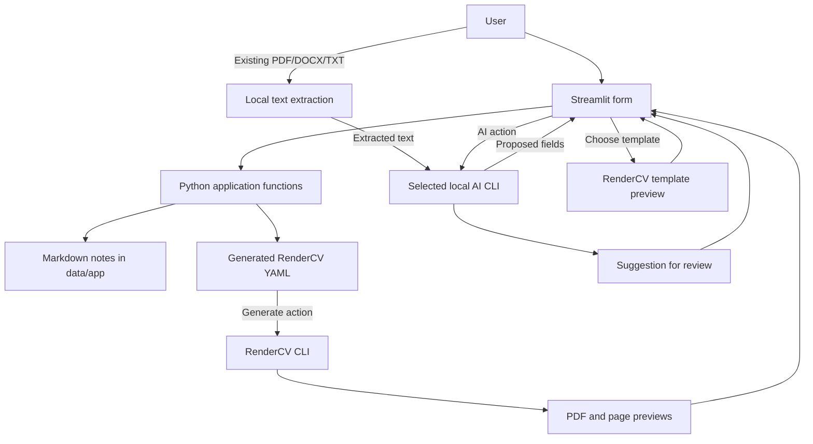

# Resume Studio architecture

Status: MVP implemented. Follow-on writing tools are planned.

## Scope

This is a local, single-user Streamlit app. Users manage profile details (including an optional photo), professional summary, experience, categorized achievements, education, certifications, skills, languages, and links. They can choose Codex CLI, Gemini CLI, or Claude Code for AI-assisted tasks and generate a PDF with RenderCV.

Existing `data/` notes and `resumes/` files are preserved. The app writes new role, achievement, and profile Markdown under `data/app/`. Generated RenderCV YAML and rendered files go under `resumes/generated/`. Both output directories are gitignored. The starter YAML and existing resume files are inputs/examples and are never overwritten.

The Markdown files are reusable career source material. The generated YAML is the structured CV used by RenderCV. A generated PDF is the resume artifact users can preview and download.

## Stack and component design

| Part | Choice | Responsibility |
| --- | --- | --- |
| UI | Streamlit | Forms, import review, AI suggestion review, template previews, navigable download lists |
| Application logic | Python | Extract uploaded document text, map form fields to CV structure, and orchestrate actions |
| Persistence | PyYAML and Markdown files | Write YAML and user-authored notes |
| AI adapter | Local CLI subprocesses | Route prompts and structured output through the selected Codex CLI, Gemini CLI, or Claude Code |
| File readers | pypdf and python-docx | Extract selectable PDF text, DOCX paragraphs/tables, and UTF-8 text |
| PDF generation | RenderCV 2.8 subprocess | Validate YAML and render PDF/PNG/HTML/Typst outputs |



There is no separate web API, database, or job queue in the MVP. Subprocesses run synchronously from explicit buttons, with a spinner, timeout, and captured error message. This fits the local single-user workflow. A durable job worker can be added if the app becomes multi-user or jobs need to continue after the browser disconnects.

The current provider selector runs each vendor's local CLI and uses its existing sign-in. Direct LLM API-key integrations are deferred: they would add app-managed secret storage, model and billing controls, and separate provider adapters. They become useful if Resume Studio is hosted for multiple users or needs provider choices independent of locally installed CLIs. Keep the provider adapter boundary so API transports can be added later without changing CV workflows.

## User workflow

1. On first launch, load `resumes/Fani_Bhushan_CV.yaml`. On later launches, use the most recently saved YAML under `resumes/generated/` when one exists. The sidebar has one **Load an existing CV** uploader for YAML/YML, PDF, DOCX, and TXT. RenderCV YAML loads directly.
2. For a PDF, DOCX, or TXT upload, local readers extract text and the selected AI CLI proposes values for the editor fields. Review and correct the loaded fields; the uploaded document is not saved by the app.
3. Edit profile, summary, roles, education, certifications, skills, languages, links, and achievements in the Streamlit tabs.
4. Optionally turn on **ATS mode** in the sidebar and paste a target job description. ATS mode is off by default. Use the ATS Checker tab to review keyword alignment, evidence gaps, formatting concerns, and targeted rewrite suggestions. While enabled, every text refinement uses that job description as context.
5. Enter achievements in one field. Use **Categorize achievements** to assign each line to Technical, Leadership, or Product by primary impact, then review and accept the grouping. Use **Refine achievements** for a wording suggestion; accept or reject it separately.
6. Use **Save Markdown + YAML** to write source notes under `data/app/` and a RenderCV YAML under `resumes/generated/`.
7. Choose a RenderCV template to preview it with sample CV content, even when your draft is blank. Your information is not used in the sample preview; the selected template is used for PDF generation.
8. Use **Generate PDF**. The app saves first, runs RenderCV, and offers the result from the Files view.
9. Open **Files** and switch between **Markdown** and **CVs** to see downloadable lists. The UI displays artifact names and download actions, not local output locations.

Ordinary editing and PDF generation do not require an AI CLI. Importing PDF/DOCX/TXT, categorizing new or changed achievements, ATS checks, and optional wording refinement require the selected CLI and its local authentication. In ATS mode the target job description is passed as context to both the checker and every text refinement. The extracted CV text is passed to the configured local CLI; the user reviews proposed field values before saving. An uploaded photo is copied to the ignored `data/app/` folder and referenced by a relative path in generated YAML.

Streamlit widgets are keyed and outside `st.form`, so edits reach Session State on each rerun. AI import, refinement, achievement classification, and final PDF generation run only after explicit user actions. Selecting a template is an explicit preview action; later edits mark a draft preview stale and require a refresh. When a button needs to update an already-rendered widget, queue that state change and apply it at the beginning of the next rerun.

## Files and data mapping

```text
app.py                         # Streamlit UI and form-to-CV mapping
src/cv_builder/storage.py      # YAML/Markdown persistence
src/cv_builder/importing.py    # Local PDF, DOCX, and TXT text extraction
src/cv_builder/processes.py    # AI CLI adapters, import/refinement, and RenderCV subprocesses
data/                          # existing career notes; preserved
data/app/profile.md            # app-authored profile/skills; gitignored
data/app/profile-photo-*.png   # uploaded CV photos; gitignored
data/app/roles/*.md            # app-authored role notes; gitignored
data/app/achievements/*.md     # app-authored achievement notes; gitignored
resumes/Fani_Bhushan_CV.yaml   # existing starter input; preserved
resumes/generated/*            # generated Markdown/YAML/PDF and RenderCV files; gitignored
```

The form maps to RenderCV fields as follows:

| Form content | RenderCV YAML |
| --- | --- |
| Name and contact details | `cv.name`, `cv.location`, `cv.email`, `cv.phone`, `cv.social_networks`, `cv.website` |
| About | `cv.sections.professional_summary` |
| Experience | `cv.sections.experience`, including `highlights` |
| Technical/leadership/product achievements | Matching achievement sections |
| Education and certifications | `cv.sections.education`, `cv.sections.certifications` |
| Skills and languages | `cv.sections.skills`, `cv.sections.languages` |
| Theme and rendering settings | Existing `design` and `settings`, with a generated output folder |

Keep phone numbers as quoted strings so YAML cannot reinterpret them as numbers or remove leading zeros. RenderCV requires a valid international number with a country code; the field is optional. Map supported named networks to `cv.social_networks`; map personal and portfolio URLs to RenderCV's separate `cv.website` field.

Keep imported RenderCV sections and design settings that the form does not expose. PyYAML preserves data values but not comments or original formatting. RenderCV 2.8 performs final schema validation during generation. New Markdown is written to the separate `data/app/` subtree, so existing notes under `data/roles`, `data/achievements`, and other current paths are not replaced.

Writes use temporary files followed by an atomic rename. Each generated CV has its own YAML and RenderCV output folder under `resumes/generated/`. Never accept arbitrary output paths from uploaded YAML; overwrite the output folder with the app-controlled folder before saving.

## AI provider workflow

The MVP offers refinement for the summary, role achievement text, and the combined achievement field. It classifies the combined achievements into technical, leadership, and product groups through a separate structured Codex action. With ATS mode enabled, every refinement also receives the target job description and is instructed to use only supported overlap. The application:

1. Passes the selected text and small amount of role context to the selected CLI using a fixed prompt and argument list, without a shell.
2. Uses structured output where needed and a three- or four-minute timeout depending on the operation. Codex runs in a read-only sandbox, Gemini runs in plan mode, and Claude Code runs with built-in tools disabled. Prompts ask every provider to preserve supplied names, dates, technologies, and metrics, and forbid adding unsupported facts.
3. Displays the returned text beside the original. The provider never edits YAML or Markdown directly.
4. Applies the text only after the user clicks **Apply suggestion**. **Reject suggestion** leaves the draft unchanged.

Achievement classification preserves each input line verbatim, assigns it to one primary category, and displays the groups for user review. Saving is blocked if achievement text has changed since the last accepted classification. The Other sections tab explains each category and gives guidance on writing concise, evidence-based achievements.

Treat the output as a suggestion: prompt instructions do not guarantee factual accuracy. A missing CLI, authentication error, timeout, or empty response is shown in the app, and the manual workflow remains available.

## RenderCV flow

The import flow extracts text locally from selectable-text PDFs, DOCX paragraphs/tables, and TXT files (maximum upload 20 MB and extracted text 120,000 characters). Empty-text PDFs are identified as likely scans; OCR and legacy `.doc` are not supported in the MVP. The selected AI CLI maps extracted text into a structured response that the app validates and converts into existing editor fields. The upload is processed in memory and never overwrites a saved CV. Extraction or mapping errors are shown without changing the current editor state.

The template chooser renders sample CV content using one of RenderCV 2.8's nine built-in themes, even if the user has not entered data. Preview YAML, PDF, and PNG pages stay under the ignored generated output subtree; user CV information is not used. Generate saves current Markdown and YAML, applies the selected theme, sets a CV-specific output folder, and invokes `rendercv render <yaml-path>` with an argument array and timeout. A successful process must produce a nonempty PDF. Markdown, YAML, and PDF files are downloadable from the Files view.

## ATS mode

ATS mode is a sidebar toggle that defaults to off. When enabled, the user can paste a job description or load one from a text-based PDF, DOCX, TXT, or Markdown file into the editable field. The ATS Checker tab runs a non-mutating alignment review that identifies matching and missing terms, evidence gaps, formatting concerns, and specific rewrite suggestions tied to RenderCV field paths. It does not claim a vendor-specific ATS score and does not update the CV. Every refinement action receives the same job description while the toggle is on; pending suggestions become invalid if the toggle state or job description changes. Turning ATS mode off restores general-purpose refinement.

## Separate cover letter page

Cover Letter is a separate top-level page from CV Builder with a two-pane layout: CV and job description text/file inputs are on the left, while the editable draft and save/download actions are on the right. It offers two starting points: an existing CV (selectable-text PDF, RenderCV YAML/YML, DOCX, or TXT) or a blank draft from a user-written background description. Either path can include a job description pasted into the field or loaded from a text-based PDF, DOCX, TXT, or Markdown file. Uploaded documents are processed in memory: YAML is validated and serialized, while PDF/DOCX/TXT text uses the same local extraction utility as CV import. The selected AI provider receives the source material as untrusted data and is instructed not to invent qualifications, results, metrics, or motivations. Users can download the letter as Markdown or save it under the ignored `data/app/cover-letters/` folder, where it appears in CV Builder → Files → Markdown. Scanned PDF OCR and legacy `.doc` are outside the MVP.

## Follow-on capabilities

The repository already has agent skill instructions in `.agents/skills/`. Add these as separate, user-triggered actions after the authoring and rendering MVP:

| Capability | Skill reference | Inputs and output |
| --- | --- | --- |
| STAR story generator | `star-story-generator` | Role/achievement evidence → reviewed STAR story Markdown in `data/app/star-stories/` |
| Achievement extractor | `achievement-extractor` | Existing role notes → supported, categorized achievement Markdown in `data/app/achievements/` |
| Resume reviewer | `resume-reviewer` | Selected YAML and writing guidelines → review findings shown in UI and saved as a review Markdown artifact when requested |

Keep each operation optional and reviewable. Generated drafts must preserve evidence, avoid invented facts or metrics, and require user acceptance before they replace saved CV content. Job descriptions remain in the existing `job-descriptions/` folder. Preserve the current skill files and career notes as inputs.

## Implementation status

- [x] Streamlit authoring UI for profile, summary, experience, achievements, education, certifications, skills, and languages.
- [x] Save role/profile/achievement Markdown under `data/app/` and generated YAML under `resumes/generated/`.
- [x] Selectable Codex CLI, Gemini CLI, and Claude Code providers for import, refinement, categorization, ATS review, and cover letters.
- [x] Upload an optional PNG/JPEG profile photo and include it in generated YAML.
- [x] Generate and preview/download a RenderCV PDF.
- [x] Preview built-in RenderCV templates with sample CV content and browse Markdown/CV downloads without displaying local paths.
- [x] Import text-based PDF, DOCX, and TXT CVs into editable form fields for user review.
- [x] Add field-level validation for contact details, links, and experience/education dates; block saving and rendering until invalid entries are fixed.
- [x] Add opt-in ATS alignment review and job-description-aware refinement.
- [x] Draft an editable cover letter from an existing CV or a user description, optionally tailored to a job description, with Markdown download/save.
- [ ] Add Star story generator, achievement extractor, and resume reviewer actions.

## References

- [Codex non-interactive mode](https://learn.chatgpt.com/docs/non-interactive-mode)
- [RenderCV YAML structure](https://docs.rendercv.com/user_guide/yaml_input_structure/)
- [Streamlit forms](https://docs.streamlit.io/develop/concepts/architecture/forms)
- [Streamlit threading](https://docs.streamlit.io/develop/concepts/design/multithreading)
