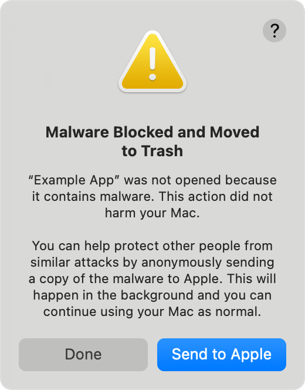

# Install Resume Studio on macOS

Choose the installer for your Mac: **Apple silicon** (`arm64`) or **Intel** (`x64`). Open the DMG and drag Resume Studio into **Applications**.

## macOS security: read the exact warning

Resume Studio is free and is **not notarized by Apple**. Only continue if you downloaded the app from the project's [official GitHub Releases](https://github.com/FaniBhushan/ResumeStudio/releases).

**The alert matters.** “Apple cannot check it for malicious software” and “the app is damaged” are different messages. Follow only the instructions for the alert you actually see.

### “Apple cannot check it for malicious software”

This means Apple has not notarized the app. If you trust the release you downloaded:

1. Try opening Resume Studio once.
2. Open **System Settings → Privacy & Security**.
3. In the Security section, select **Open Anyway** for Resume Studio.
4. Review and confirm the prompt.

<figure markdown="span">
  { .mac-screenshot }
  <figcaption>Apple’s example of the Privacy & Security approval. The button appears after you try opening the app.</figcaption>
</figure>

### “The app is damaged and moved to the Bin”

**Stop. Do not use Open Anyway or commands that disable macOS security checks.** Apple says this alert may indicate the app is corrupted or altered, or that macOS blocked it as malware. Do not remove quarantine attributes or bypass this warning.

Check that you downloaded the newest installer from the official Releases page. If the latest build still produces this alert, do not run it; report the issue on [GitHub Issues](https://github.com/FaniBhushan/ResumeStudio/issues) and include the macOS version, processor type, release tag, and exact alert text.

<figure markdown="span">
  { .mac-screenshot }
  <figcaption>Apple’s example of the malware-block alert. It is different from the “cannot check” warning above.</figcaption>
</figure>

See [Apple's guidance for safely opening Mac apps](https://support.apple.com/en-ie/102445).

## If clicking the app does nothing

Resume Studio may already be running in the background. Check `http://127.0.0.1:8501`. If the page is not open, quit any existing Resume Studio process in Activity Monitor, then launch the app again. When you finish, use **Quit** from the app’s Dock icon; closing the browser tab alone does not stop its local server.

[Return to the general installation guide](install.md).
